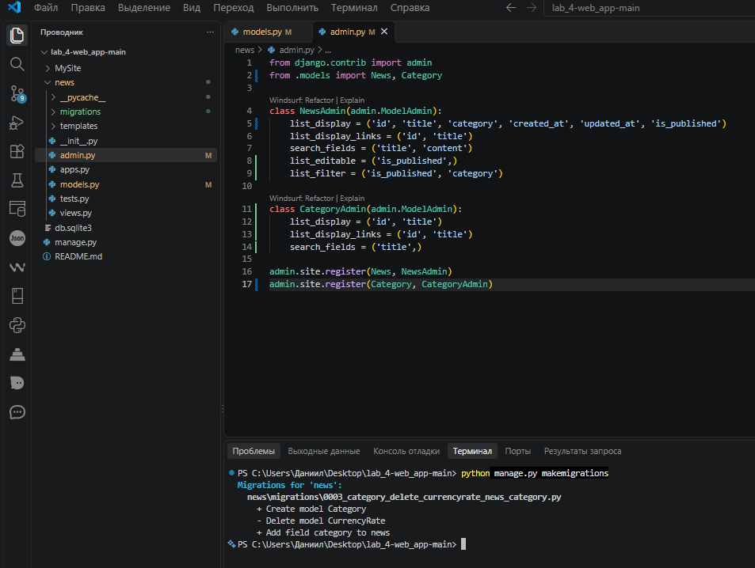
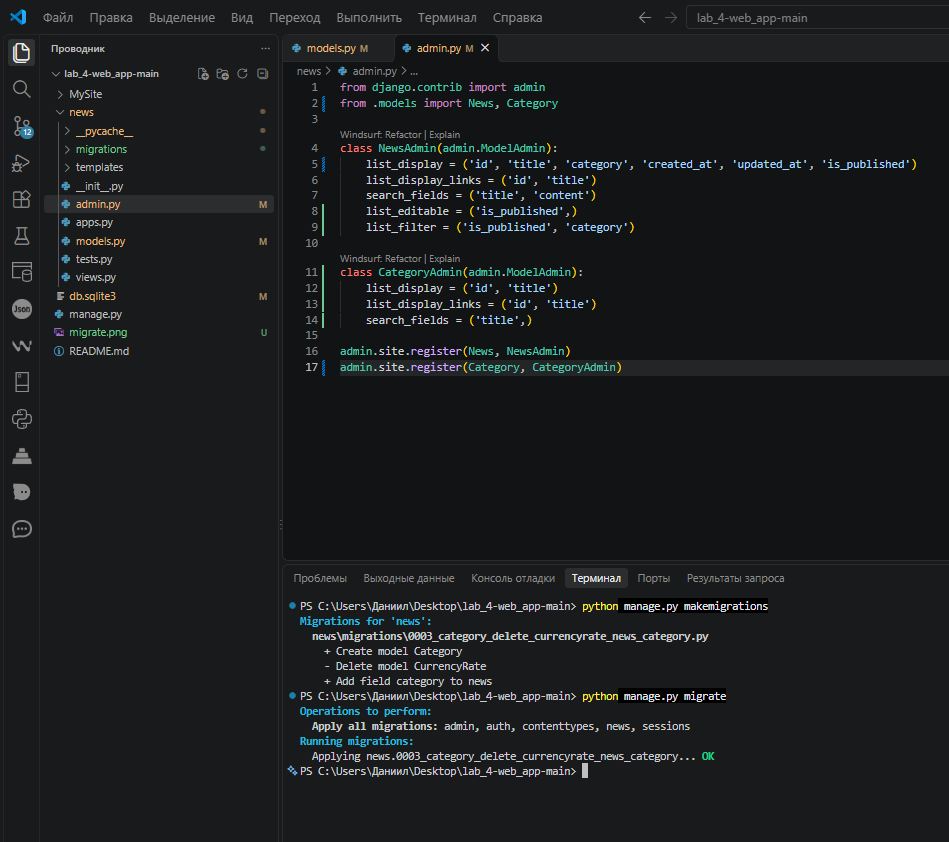
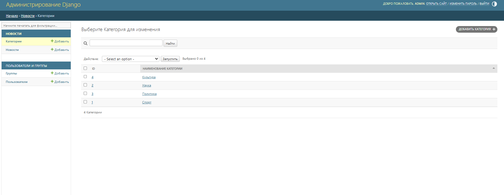
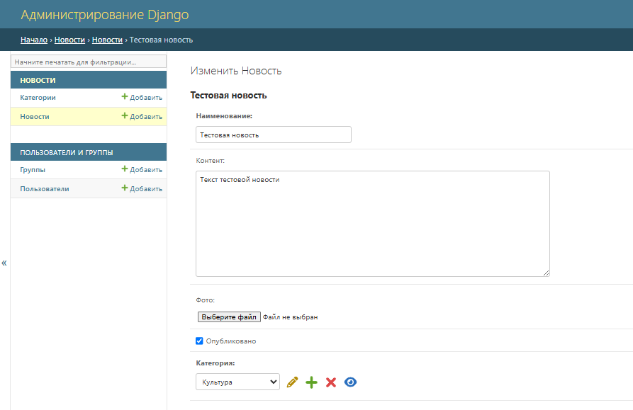
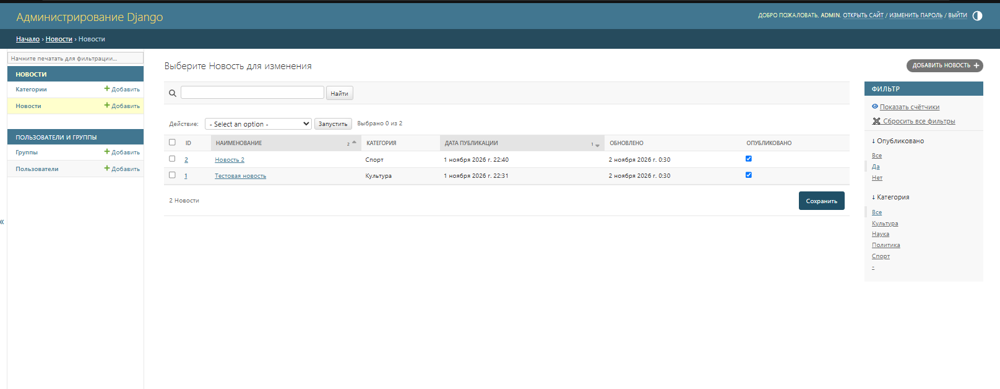

# Лабораторная работа № 4: Связи моделей в Django

**Тема:** создание связей между моделями и настройка отображения связанных данных в панели администратора.  
**Проект:** новостной сайт.  
**Тип связи:** `ForeignKey` — одна категория может быть связана со многими новостями.

## Содержание

- [Цель работы](#цель-работы)
- [Теоретическое обоснование](#теоретическое-обоснование)
- [Структура проекта](#структура-проекта)
- [Установка и запуск](#установка-и-запуск)
- [Реализация лабораторной работы](#реализация-лабораторной-работы)
- [Скриншоты результатов](#скриншоты-результатов)
- [Контрольные вопросы](#контрольные-вопросы)
- [Вывод](#вывод)

## Цель работы

Освоить создание и настройку связей между моделями Django, изучить параметры связи `ForeignKey` и `on_delete`, применить миграции при добавлении связи к существующей модели и настроить отображение связанных данных в административной панели Django.

## Теоретическое обоснование

В Django модели описывают структуру данных, хранящихся в базе данных. Для организации связей между таблицами используются специальные поля:

- **`ForeignKey`** — связь «многие к одному». Например, несколько новостей могут относиться к одной категории.
- **`ManyToManyField`** — связь «многие ко многим». Например, у публикации может быть несколько тегов, а один тег может использоваться в нескольких публикациях.
- **`OneToOneField`** — связь «один к одному». Например, у пользователя может быть один профиль.

Параметр **`on_delete`** определяет поведение при удалении объекта, на который ссылается внешний ключ. В данном проекте используется `models.PROTECT`: категория не удаляется, если на неё ссылаются новости.

Параметр **`null=True`** разрешает хранить в соответствующем столбце базы данных значение `NULL`. В модели `News` он задан для поля `category`, поэтому связь с категорией может отсутствовать. Параметр `blank=True` относится к проверке заполнения поля на уровне форм Django; он не задан для `category`.

**Миграции** позволяют переносить изменения моделей в структуру базы данных. Команда `makemigrations` создаёт файлы миграций, а `migrate` применяет их.

## Структура проекта

```text
lab_4-web_app-main/
├── manage.py
├── db.sqlite3
├── makemigrations.png
├── migrate.png
├── admin_categories_list.png
├── admin_news_edit_category.png
├── admin_news_list_filter.png
├── MySite/
│   ├── settings.py
│   ├── urls.py
│   ├── asgi.py
│   └── wsgi.py
└── news/
    ├── migrations/
    │   ├── 0001_initial.py
    │   ├── 0002_news_alter_currencyrate_change_percent.py
    │   └── 0003_category_delete_currencyrate_news_category.py
    ├── templates/
    │   └── news/
    │       └── index.html
    ├── admin.py
    ├── apps.py
    ├── models.py
    ├── views.py
    └── tests.py
```

Назначение основных файлов:

- `manage.py` — запуск команд управления Django.
- `MySite/settings.py` — настройки проекта и подключение приложения `news`; используется SQLite.
- `MySite/urls.py` — маршруты административной панели и страницы новостей.
- `news/models.py` — модели `Category` и `News`.
- `news/admin.py` — регистрация моделей и настройка списков, поиска и фильтров в админке.
- `news/views.py` — получение новостей из базы данных и передача их шаблону.
- `news/templates/news/index.html` — HTML-шаблон списка новостей.
- `news/migrations/` — миграции базы данных.
- `db.sqlite3` — файл базы данных SQLite.

## Установка и запуск

Для запуска необходим Python и установленные пакеты Django и Pillow. Pillow требуется Django для работы с `ImageField`. В архиве проекта отдельный файл `requirements.txt` отсутствует.

1. Распаковать архив и открыть терминал в папке проекта, где находится `manage.py`.
2. Создать виртуальное окружение:

   ```bash
   python -m venv venv
   ```

3. Активировать виртуальное окружение.

   **Windows:**
   ```bash
   venv\Scripts\activate
   ```

   **Linux / macOS:**
   ```bash
   source venv/bin/activate
   ```

4. Установить зависимости:

   ```bash
   pip install django pillow
   ```

5. Применить миграции:

   ```bash
   python manage.py migrate
   ```

6. При необходимости создать пользователя для административной панели:

   ```bash
   python manage.py createsuperuser
   ```

7. Запустить сервер разработки:

   ```bash
   python manage.py runserver
   ```

После запуска:

- страница новостей: <http://127.0.0.1:8000/news/>
- панель администратора: <http://127.0.0.1:8000/admin/>

Для входа в админку используется учётная запись суперпользователя. Если база данных уже содержит нужные записи и учётную запись, повторное создание пользователя не требуется.

## Реализация лабораторной работы

### 1. Создание модели `Category`

В `news/models.py` определена модель категории:

```python
class Category(models.Model):
    title = models.CharField(
        max_length=150,
        db_index=True,
        verbose_name='Наименование категории'
    )

    def __str__(self):
        return self.title

    class Meta:
        verbose_name = 'Категория'
        verbose_name_plural = 'Категории'
        ordering = ['title']
```

Поле `title` хранит название категории. Параметр `db_index=True` создаёт индекс для поля, что может ускорить поиск по нему. Метод `__str__` возвращает название категории, поэтому объект удобно отображается в административной панели. Сортировка категорий задаётся параметром `ordering = ['title']`.

### 2. Связь модели `News` с `Category`

Модель `News` содержит поле `category`:

```python
category = models.ForeignKey(
    Category,
    on_delete=models.PROTECT,
    null=True,
    verbose_name='Категория'
)
```

Это связь **один-ко-многим**: одной категории может соответствовать несколько новостей, а каждая новость с заполненным полем `category` ссылается на одну категорию.

Параметры поля:

- `ForeignKey(Category, ...)` — задаёт ссылку на модель категории.
- `on_delete=models.PROTECT` — запрещает удалять категорию, если на неё ссылаются новости.
- `null=True` — разрешает отсутствие категории в базе данных, что также упрощает добавление связи к уже существующим записям.
- `verbose_name='Категория'` — задаёт подпись поля в интерфейсе Django.

В модели `News` также определены поля:

| Поле | Тип | Назначение |
|---|---|---|
| `title` | `CharField` | Заголовок новости |
| `content` | `TextField` | Текст новости; допускает пустое значение (`blank=True`) |
| `created_at` | `DateTimeField` | Дата и время создания (`auto_now_add=True`) |
| `updated_at` | `DateTimeField` | Дата и время последнего сохранения (`auto_now=True`) |
| `photo` | `ImageField` | Фотография новости; допускает пустое значение |
| `is_published` | `BooleanField` | Признак публикации, по умолчанию `True` |
| `category` | `ForeignKey` | Связанная категория новости |

Метод `__str__` возвращает заголовок новости. Для модели задана сортировка `ordering = ['-created_at', 'title']`: сначала показываются более новые новости, а при совпадении даты используется название.

### 3. Создание и применение миграций

В проекте присутствуют миграции, отражающие изменения структуры моделей. В частности, миграция `0003_category_delete_currencyrate_news_category.py` создаёт модель `Category`, удаляет прежнюю модель `CurrencyRate` и добавляет поле `category` в модель `News`.

Основные команды для создания и применения миграций:

```bash
python manage.py makemigrations
python manage.py migrate
```

`makemigrations` формирует файлы миграций на основе изменений моделей, а `migrate` применяет их к базе данных. После применения миграций таблицы и внешний ключ должны соответствовать актуальным моделям.

### 4. Настройка панели администратора

В `news/admin.py` для модели `News` задан следующий класс настройки:

```python
class NewsAdmin(admin.ModelAdmin):
    list_display = (
        'id', 'title', 'category',
        'created_at', 'updated_at', 'is_published'
    )
    list_display_links = ('id', 'title')
    search_fields = ('title', 'content')
    list_editable = ('is_published',)
    list_filter = ('is_published', 'category')
```

Используются параметры:

- `list_display` — отображает ID, заголовок, категорию, дату создания, дату обновления и статус публикации.
- `list_display_links` — делает ID и заголовок ссылками на страницу редактирования.
- `search_fields` — добавляет поиск по заголовку и содержимому новости.
- `list_editable` — позволяет менять признак публикации непосредственно в списке.
- `list_filter` — добавляет фильтры по статусу публикации и категории.

Для `Category` также настроена административная панель: список показывает ID и название, а поиск выполняется по названию. Обе модели зарегистрированы через `admin.site.register()`.

### 5. Отображение новостей на странице

В `news/views.py` функция `index` получает все записи модели `News` через `News.objects.all()` и передаёт их в шаблон `news/index.html` с помощью `render()`.

Шаблон перебирает переданный список циклом `` и отображает заголовок, содержание и дату публикации. Если записей нет, выводится сообщение «Новостей пока нет».

## Скриншоты результатов

Скриншоты ниже уже находятся в архиве проекта. Пути указаны относительно корневой папки проекта.

### 1. Создание миграций



*Скриншот команды `makemigrations`.*

### 2. Применение миграций



*Скриншот команды `migrate`.*

### 3. Список категорий в административной панели



*Отображение зарегистрированной модели `Category` в админке.*

### 4. Редактирование новости и выбор категории



*Форма новости с полем связи с категорией.*

### 5. Список новостей и фильтры



*Список новостей в административной панели с отображением категории и настройками фильтрации.*

## Контрольные вопросы

### 1. Для чего нужны связи между моделями Django?

Связи позволяют хранить связанные данные в отдельных таблицах и обращаться к ним через ORM Django. Это помогает избегать дублирования данных и поддерживать их целостность.

### 2. Чем отличаются `ForeignKey`, `ManyToManyField` и `OneToOneField`?

- `ForeignKey` — многие к одному: несколько новостей могут относиться к одной категории.
- `ManyToManyField` — многие ко многим: несколько объектов одной модели могут быть связаны с несколькими объектами другой модели.
- `OneToOneField` — один к одному: одному объекту соответствует не более одного объекта другой модели в рамках этой связи.

### 3. Для чего используется параметр `on_delete`?

Он определяет, что Django должен делать с объектами, ссылающимися на удаляемый объект. В проекте `models.PROTECT` запрещает удалять категорию, пока с ней связаны новости. Другие варианты включают `CASCADE` и `SET_NULL`, поведение которых зависит от выбранной стратегии удаления.

### 4. Чем отличаются `null=True` и `blank=True`?

`null=True` разрешает хранить `NULL` в столбце базы данных. `blank=True` разрешает оставлять поле пустым при валидации форм Django. В модели `News` для `category` задан `null=True`, но `blank=True` не указан.

### 5. Что такое миграции и какие команды используются для работы с ними?

Миграции описывают изменения структуры базы данных. Команда `python manage.py makemigrations` создаёт файлы миграций, а `python manage.py migrate` применяет их к базе данных.

### 6. Что делает `related_name` и используется ли он в этом проекте?

`related_name` задаёт имя обратной связи, через которую можно получить связанные объекты от родительской модели. В поле `category` модели `News` параметр `related_name` не указан, поэтому используется стандартное имя обратной связи Django.

### 7. Для чего нужен метод `__str__` в модели?

Метод `__str__` определяет удобное строковое представление объекта. В проекте категория отображается по названию, а новость — по заголовку, поэтому записи проще различать в админке и консоли.

### 8. Для чего предназначены `list_display`, `list_filter`, `list_editable` и `search_fields`?

- `list_display` задаёт столбцы списка объектов в админке.
- `list_filter` добавляет фильтры.
- `list_editable` разрешает редактировать указанные поля прямо в списке.
- `search_fields` задаёт поля, по которым выполняется поиск.

### 9. Что произойдёт при попытке удалить категорию, к которой относятся новости?

Удаление будет заблокировано из-за `on_delete=models.PROTECT`. Сначала необходимо переназначить связанные новости на другую категорию или удалить/изменить связи другим допустимым способом.

### 10. Зачем регистрировать модели в `admin.py`?

Регистрация делает модели доступными для управления через встроенную административную панель Django. Классы `ModelAdmin` позволяют настроить отображение полей, поиск, фильтры и редактирование записей.

## Вывод

В ходе лабораторной работы были созданы модели `Category` и `News` и настроена связь `ForeignKey` между ними. Для поля категории использованы `on_delete=models.PROTECT` и `null=True`. Были подготовлены миграции, а в административной панели настроены отображаемые столбцы, поиск, фильтры и редактирование статуса публикации. Также реализовано отображение списка новостей с помощью Django-представления и HTML-шаблона.

В результате изучены принципы организации связей между моделями Django, применения миграций и управления связанными данными через административную панель.
